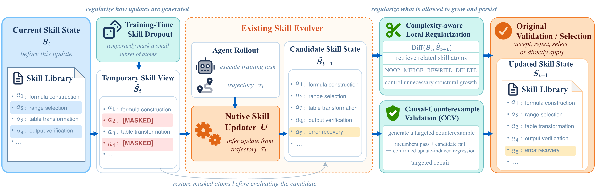

# SkillEvoReg: Regularizing Self-Evolving Agent Skills

Agents can improve from experience by continually updating reusable skills,
but repeated updates can also accumulate redundant or task-specific rules and
break previously successful behaviors. **SkillEvoReg** brings regularization
principles from neural-network training to this skill-evolution process,
without replacing the host framework's native skill updater.

It combines **training-time skill dropout** to reduce reliance on individual
instructions, **complexity-aware local editing** to control unnecessary skill
growth, and **Causal Counterexample Validation (CCV)** to detect behavioral
regressions through paired incumbent/candidate checks and trigger targeted
repairs. This repository includes integrations with **SkillOpt**,
**SkillEvolBench**, and **ContinualSkillBench**, retaining each host's native
acceptance or commit mechanism.



## Setup

Python 3.12 is recommended. Use separate environments for each host framework:

```bash
python3.12 -m venv .venv
source .venv/bin/activate
python -m pip install -r requirements/skillopt.txt
```

Use `requirements/skillevolbench.txt` or `requirements/continual.txt` for the
other hosts. Docker and the Codex CLI are required where the agent runtime uses
them. Configure credentials and the local embedding-model path using
[.env.example](.env.example).

## Run

```bash
python scripts/run.py list
python scripts/run.py skillopt spreadsheet baseline --execute
python scripts/run.py skillopt spreadsheet skillevoreg --execute
```

Commands print their execution plan unless `--execute` is supplied.
See [reproduction.md](docs/reproduction.md) for all frameworks and
[data.md](docs/data.md) for required data.

## Layout

| Path | Contents |
|---|---|
| `configs/` | Baseline and SkillEvoReg configurations |
| `experiments.json` | Training and evaluation entrypoints |
| `scripts/` | Launch, evaluation, data staging and test commands |
| `benchmark/third_party/SkillOpt/` | SkillOpt with regularization integration |
| `benchmark/third_party/SkillEvolBench/` | SkillEvolBench with regularization integration |
| `benchmark/integrations/continual_regularization/` | Continual training adapter |
| `benchmark/integrations/continual_holdout/` | Frozen-library evaluation |
| `vendor/` | Host-specific Harbor runtime sources |
| `data/manifests/` | Task memberships and fixed-order metadata |
| `tests/` | Entrypoint and configuration checks |

Regularization implementations live inside the corresponding host modules.
SkillOpt uses `skillopt/regularization/` and environment `agentic_ccv.py` files.
SkillEvolBench uses `skillevolbench/components/` and `harbor_ext/hooks.py`.
Continual uses `benchmark/integrations/continual_regularization/`.
The model prompts are defined in these source files.

## Tests

```bash
python scripts/verify_release.py
python -m pytest -q tests
python scripts/test_offline.py skillopt
python scripts/test_offline.py skillevolbench
python scripts/cache_tokenizer.py
python scripts/test_offline.py continual
```

Run framework tests in their matching dependency environment. Tokenizer
preparation downloads a public vocabulary; the tests do not call model APIs.

Dataset attachments, model weights, credentials and generated outputs are not
included.
